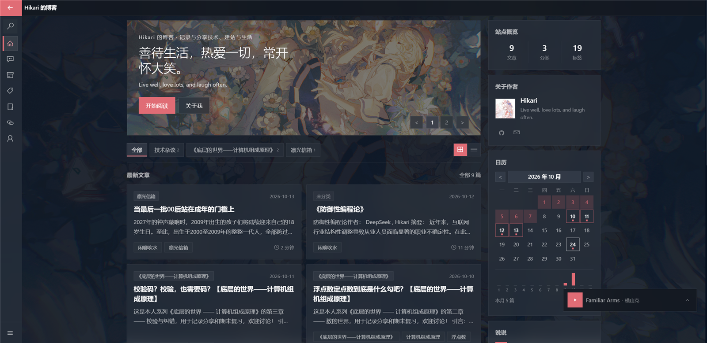

# restart-fluent

[](https://hexo.io)
[](https://nodejs.org)
[](https://ejs.co)
[](./LICENSE)
[](#设计风格)

一个 Windows 10 Fluent Design 风格的 Hexo 主题：亚克力、Reveal 高光、明暗双主题、pjax 无刷新切页与常驻音乐播放器。

适用于 Hexo 7.x / Node.js 18+。



## 特性

**外观**

- Win10 Fluent Design：亚克力模糊、Reveal 高光、边缘光、按压缩放
- 明暗双主题，支持跟随系统或手动切换
- 侧栏 8 色主题色板、紧凑模式、光效开关、侧栏折叠
- 壁纸背景与暗色遮罩，可切换为纯色

**页面**

- UWP 风格标题栏与左侧导航
- 首页 Hero 幻灯片、网格 / 列表信息流
- 站点概览、关于作者、日历、最近说说侧栏
- 归档、分类、标签、友链、关于、搜索、404

**阅读与交互**

- pjax 无刷新切页，音乐播放器切页不断播
- 文章目录、阅读进度、上下篇、分享海报与二维码
- 代码块复制、层级折叠、长块折叠、行号
- Twikoo 评论与「说说」页

**正文增强**

- 黑幕、GitHub 仓库卡片
- KaTeX 数学公式、Mermaid 流程图
- 正文音乐卡片、正 / 倒计时卡片
- 图片注释、图片与流程图查看器
- RSS、canonical、Open Graph、Twitter Card、JSON-LD

## 设计风格

主题以 **Windows 10** Fluent Design 为基准，而非 Win11 的圆角与 Mica：

- **Acrylic 亚克力**：半透明背景 + `backdrop-filter` 模糊，默认 `24px`
- **Reveal 高光**：鼠标移动时出现径向光晕，配合边缘光与按压回弹
- **设计令牌**：颜色、阴影、圆角、边框统一由 CSS 变量管理，明暗主题共享一套结构
- **三层底色**：壁纸上的卡片、页面级面板、卡片内嵌套元素分层使用不同透明度
- **主题色板**：蓝 / 青 / 绿 / 紫 / 洋红 / 红 / 橙 / 粉，访客选择保存在浏览器
- **UWP 外壳**：顶部返回键 + 页面标题 + 侧栏按钮，左侧导航可折叠为图标栏
- **内容优先**：动效可关闭，`prefers-reduced-motion` 下自动降级

## 快速部署

适用于已经有 Hexo 7.x 站点的读者。

```bash
cd your-hexo-site

# 1. 安装主题
git clone https://github.com/hisuifeng/restart-fluent.git themes/restart-fluent

# 2. 安装基础插件
npm install hexo-renderer-ejs hexo-renderer-marked hexo-generator-index hexo-generator-archive hexo-generator-category hexo-generator-tag
```

在站点 `_config.yml` 中启用主题：

```yaml
theme: restart-fluent
```

本地预览：

```bash
hexo clean
hexo generate
hexo server
```

> 搜索、RSS、字数统计、评论、说说、播放器等功能需要额外插件或配置；页面（搜索 / 关于 / 友链等）也需要手动创建。完整清单见 [开发文档](./DEVELOPMENT.md)。

## 部署

生成静态文件：

```bash
hexo clean
hexo generate
```

把 `public/` 上传到任意静态托管即可，例如 GitHub Pages、Cloudflare Pages、Netlify、Vercel。

使用 Hexo 的 Git 部署器：

```bash
npm install hexo-deployer-git --save
hexo clean
hexo generate
hexo deploy
```

站点部署在子路径时，请同时设置站点 `_config.yml` 的 `url` 与 `root`。

## 更多文档

主题安装方式、插件对照表、配置项、页面创建、正文标签、常见问题与发布流程见 [DEVELOPMENT.md](./DEVELOPMENT.md)：

- [插件与功能对照表](./DEVELOPMENT.md#插件与功能对照表)
- [站点配置](./DEVELOPMENT.md#站点配置)
- [主题配置速查](./DEVELOPMENT.md#主题配置速查)
- [页面与模板](./DEVELOPMENT.md#页面与模板)
- [正文标签](./DEVELOPMENT.md#正文标签)
- [常见问题](./DEVELOPMENT.md#常见问题)

## License

主题采用 [MIT](./LICENSE) 授权。`source/images/` 下的示例图片不包含在 MIT 授权内，分发前请替换。
